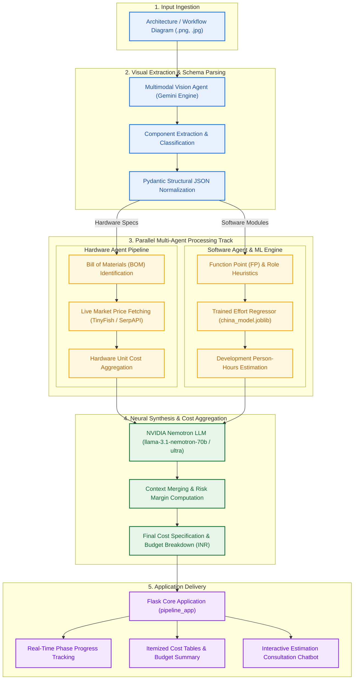
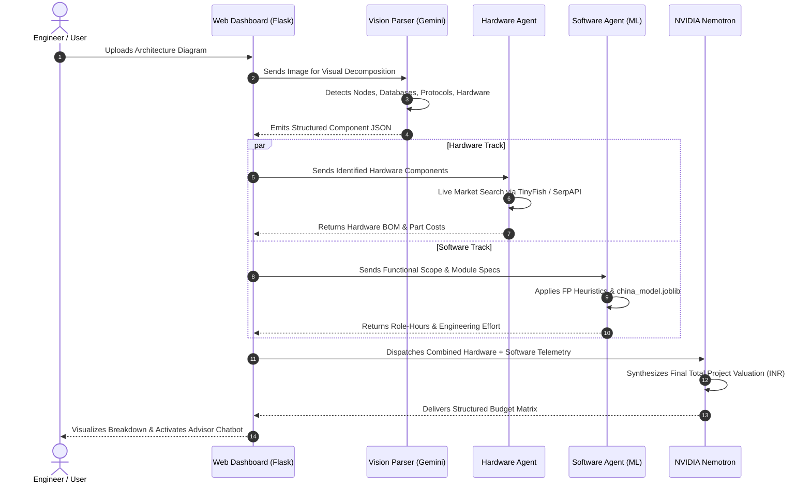

# Project Cost Estimator Pipeline

An automated, intelligent multi-agent pipeline designed to parse software and hardware architecture diagrams, extract system requirements, predict engineering effort through machine learning models, search live component market prices, and synthesize unified cost estimations.

---

## Architecture Diagram



---

## Detailed Dataflow Representation



---

## Subsystem Overview

| Component | Directory | Description |
| :--- | :--- | :--- |
| Core Pipeline Dashboard | `pipeline_app/` | Central Flask controller coordinating execution, UI rendering, and AI chat. |
| Hardware Agent | `Hardware agent/` | Automates BOM mapping and live internet price lookup using TinyFish and SerpAPI. |
| Software Agent | `software agent/` | Computes functional size, role allocations, and effort heuristics. |
| ML Models & Datasets | `Models/` | Pretrained scikit-learn models, training notebook, and effort benchmark datasets. |
| Vision Engine | `Nvidea/` | Multimodal perception pipeline extracting entities and diagrams via vision models. |
| Test Bench | `TEST images/` | Validation diagrams and reference inputs for pipeline verification. |

---

## Repository Structure

```text
Team-4C.5/
|-- .gitignore
|-- README.md
|-- Hardware agent/
|   |-- .env.example
|   |-- .gitignore
|   |-- README.md
|   |-- app.py
|   |-- requirements.txt
|   `-- templates/
|       `-- index.html
|-- Models/
|   |-- SE_Cost_Estimation_Training_Evaluation.ipynb
|   |-- dataset/
|   |   |-- COCOMO-81.csv
|   |   |-- Desharnais.csv
|   |   |-- china.arff
|   |   `-- renzo-pomodoro.csv
|   |-- models/
|   |   |-- Actual.effort/
|   |   |-- Effort/
|   |   |-- TotalLaborCost/
|   |   `-- registry.json
|   `-- requirements.txt
|-- Nvidea/
|   |-- image.py
|   |-- key.txt.example
|   `-- parts_preview.png
|-- pipeline_app/
|   |-- README.md
|   |-- app.py
|   |-- local_model.py
|   |-- requirements.txt
|   |-- static/
|   |   |-- app.js
|   |   |-- script.js
|   |   `-- style.css
|   `-- templates/
|       `-- index.html
|-- software agent/
|   |-- README.md
|   |-- app.py
|   |-- requirements.txt
|   |-- role_hours.json
|   |-- work_items_fp.json
|   `-- templates/
|       `-- index.html
`-- TEST images/
    `-- .gitkeep
```

---

## Setup and Installation

### 1. Prerequisites
- Python 3.10 or higher
- Node.js (required for live web scraping via TinyFish CLI)

### 2. Dependency Installation
Install required Python libraries:
```bash
pip install flask openai joblib numpy pydantic pillow
```

Install the TinyFish CLI globally:
```bash
npm install -g tinyfish
```

### 3. Key Configuration
Configure environment variables or credential templates:
- Hardware Agent: Copy `Hardware agent/.env.example` to `Hardware agent/.env` and specify `SERPAPI_KEY`.
- NVIDIA / Vision Model: Copy `Nvidea/key.txt.example` to `Nvidea/key.txt` and insert your NVIDIA API key, or set the environment variable:
  - Linux / macOS:
    ```bash
    export GEMINI_API_KEY="your-api-key"
    ```
  - Windows (PowerShell / Command Prompt):
    ```bash
    setx GEMINI_API_KEY "your-api-key"
    ```

### 4. Running the Application
Launch the unified pipeline dashboard:
```bash
cd pipeline_app
python app.py
```

Access the interface in your browser:
```text
http://127.0.0.1:5002
```

---

## Machine Learning Models & Datasets

The repository includes model checkpoints and evaluation artifacts trained on standard software cost metrics:
- Datasets: China Dataset, COCOMO-81, Albrecht, Maxwell, NASA93, Desharnais, and Renzo-Pomodoro.
- Metrics & Targets: Actual Effort (Person-Hours), Function Points (FP), Man-Months (MM), and Total Labor Cost.
- Training Pipeline: Implemented in `Models/SE_Cost_Estimation_Training_Evaluation.ipynb` utilizing scikit-learn regressor pipelines with joblib serialization.
