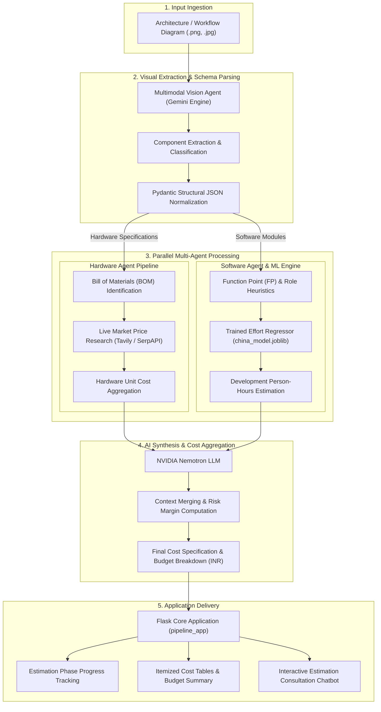
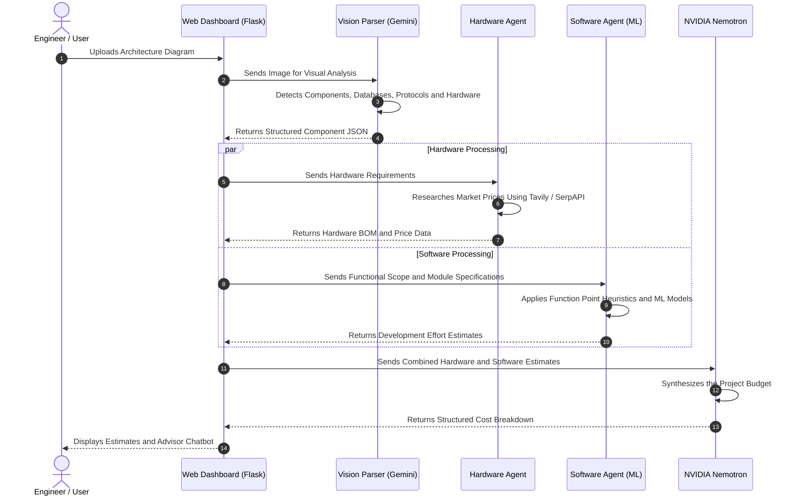

# Estimo — AI-Powered Software and Hardware Cost Estimation

Estimo is an automated, intelligent multi-agent pipeline designed to analyze software and hardware architecture diagrams, extract system requirements, predict engineering effort using machine learning models, research live component market prices, and synthesize unified project cost estimates.

The platform combines multimodal AI, machine learning, automated web research, and AI-powered cost synthesis to help students, developers, engineers, researchers, and startups estimate the resources and budget required to build technical projects.

## Architecture Diagram



## Detailed Dataflow Representation



## Subsystem Overview

| Component | Directory | Description |
|---|---|---|
| Core Pipeline Dashboard | `pipeline_app/` | Central Flask application coordinating pipeline execution, UI rendering, and AI chat. |
| Hardware Agent | `Hardware agent/` | Identifies hardware components, builds the bill of materials, and researches online prices using Tavily and SerpAPI. |
| Software Agent | `software agent/` | Estimates functional size, development roles, effort, and software engineering requirements. |
| ML Models and Datasets | `Models/` | Contains machine learning models, training notebooks, evaluation artifacts, and software effort datasets. |
| Vision Engine | `Nvidea/` | Contains the multimodal image-processing implementation for extracting components from architecture diagrams. |
| Test Bench | `TEST images/` | Stores example architecture diagrams and reference inputs for testing. |

## Repository Structure

```text
Nvidea-hackathon/
├── .gitignore
├── README.md
├── Hardware agent/
│   ├── .env.example
│   ├── .gitignore
│   ├── README.md
│   ├── app.py
│   ├── requirements.txt
│   └── templates/
│       └── index.html
├── Models/
│   ├── SE_Cost_Estimation_Training_Evaluation.ipynb
│   ├── dataset/
│   │   ├── COCOMO-81.csv
│   │   ├── Desharnais.csv
│   │   ├── china.arff
│   │   └── renzo-pomodoro.csv
│   ├── models/
│   │   ├── Actual.effort/
│   │   ├── Effort/
│   │   ├── TotalLaborCost/
│   │   └── registry.json
│   └── requirements.txt
├── Nvidea/
│   ├── image.py
│   ├── key.txt.example
│   └── parts_preview.png
├── pipeline_app/
│   ├── README.md
│   ├── app.py
│   ├── local_model.py
│   ├── requirements.txt
│   ├── static/
│   │   ├── app.js
│   │   ├── script.js
│   │   └── style.css
│   └── templates/
│       └── index.html
├── software agent/
│   ├── README.md
│   ├── app.py
│   ├── requirements.txt
│   ├── role_hours.json
│   ├── work_items_fp.json
│   └── templates/
│       └── index.html
└── TEST images/
    └── .gitkeep
```

## Setup and Installation

### 1. Prerequisites

Ensure the following are available:

- Python 3.10 or higher
- Node.js only if required by other project dependencies
- A Gemini API key for the vision integration
- An NVIDIA API key or compatible credentials for the configured Nemotron endpoint
- A Tavily API key for web research
- A SerpAPI key for search-based hardware price discovery

### 2. Install Dependencies

Clone the repository:

```bash
git clone https://github.com/Varshithkumar06/Nvidea-hackathon.git
cd Nvidea-hackathon
```

Install the core Python dependencies:

```bash
pip install flask openai joblib numpy pydantic pillow tavily-python
```

Install additional dependencies specified by each subsystem:

```bash
pip install -r "Hardware agent/requirements.txt"
pip install -r "software agent/requirements.txt"
pip install -r Models/requirements.txt
pip install -r pipeline_app/requirements.txt
```

Use a virtual environment to keep dependencies isolated. If the requirements files specify conflicting versions, install and test each subsystem in a compatible environment.

### 3. Configure API Keys

Create a `.env` file in `Hardware agent/` using `.env.example` as a reference.

Configure the required credentials:

```env
TAVILY_API_KEY=your_tavily_api_key
SERPAPI_KEY=your_serpapi_api_key
```

Configure the credentials required by the vision and synthesis integrations according to their implementations.

For Windows PowerShell, an environment variable can be set for the current session:

```powershell
$env:GEMINI_API_KEY="your_gemini_api_key"
```

For Linux or macOS:

```bash
export GEMINI_API_KEY="your_gemini_api_key"
```

Replace all example values with valid credentials. Never commit API keys, access tokens, or `.env` files to GitHub.

### 4. Run the Application

Launch the unified Flask dashboard:

```bash
cd pipeline_app
python app.py
```

Open the application in your browser:

```text
http://127.0.0.1:5002
```

The application port may differ depending on the configuration in `pipeline_app/app.py`.

## Machine Learning Models and Datasets

Estimo includes a machine learning training and evaluation workflow for software engineering effort estimation.

### Datasets

The repository includes or references datasets such as:

- China software effort dataset
- COCOMO-81
- Desharnais
- Renzo-Pomodoro

Additional datasets, including Albrecht, Maxwell, and NASA93, should be considered available only where their corresponding files or integrations are present.

### Estimation Metrics

The model pipeline addresses metrics and targets such as:

- Actual development effort in person-hours
- Function Points (FP)
- Man-Months (MM)
- Total labor cost

The training workflow is documented in:

`Models/SE_Cost_Estimation_Training_Evaluation.ipynb`

Serialized models are stored in the model directories and managed through the model registry where configured.

## Hardware Cost Research with Tavily

Tavily provides a web-search API that can support the hardware agent's online research workflow.

The hardware agent can use Tavily to discover relevant supplier pages, product listings, technical specifications, and pricing information. SerpAPI can provide an additional search source.

A reliable estimation workflow should:

1. Search for the identified component and compatible alternatives.
2. Retrieve relevant source pages and product information.
3. Extract prices, specifications, and availability only when supported by the retrieved sources.
4. Associate each price with its source and retrieval time.
5. Compare alternatives using compatibility, specifications, and price.
6. Clearly flag missing, ambiguous, or outdated pricing information.

**Important:** Search results do not guarantee that a price is current, available, or directly purchasable. Estimo should preserve source links and distinguish verified source data from estimated costs.

Tavily replaces TinyFish in this project documentation. The hardware agent's implementation must also be updated to use Tavily's API instead of any remaining TinyFish-specific code.

## Project Workflow

1. **Input:** The user uploads an architecture or workflow diagram.
2. **Vision:** Gemini analyzes the image and extracts components.
3. **Normalization:** Pydantic validates and structures the extracted information.
4. **Parallel Processing:** Hardware and software agents independently process their requirements.
5. **Hardware Research:** Tavily and SerpAPI support online component research.
6. **Effort Prediction:** Trained machine learning models estimate software development effort.
7. **Cost Synthesis:** NVIDIA Nemotron combines the results into a unified cost specification.
8. **Presentation:** The Flask dashboard displays the resulting estimates, budget breakdown, and consultation interface.

## Project Goals

Estimo aims to reduce manual engineering research, support early-stage budgeting, and make technical project estimation more systematic and transparent.

By combining AI-powered diagram analysis, machine learning, online hardware research, and multi-agent orchestration, Estimo explores a practical approach to estimating the resources needed to turn technical ideas into working systems.

## Contributing

Contributions, bug reports, and suggestions are welcome. When proposing changes, include the affected subsystem, steps to reproduce the issue, and any relevant logs or test results.

## License

A license has not yet been specified in this repository. Check the repository for licensing terms before redistributing or reusing its code.

## Repository

GitHub: https://github.com/Varshithkumar06/Nvidea-hackathon
